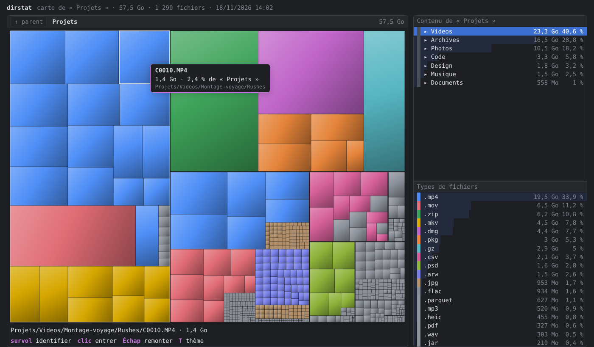
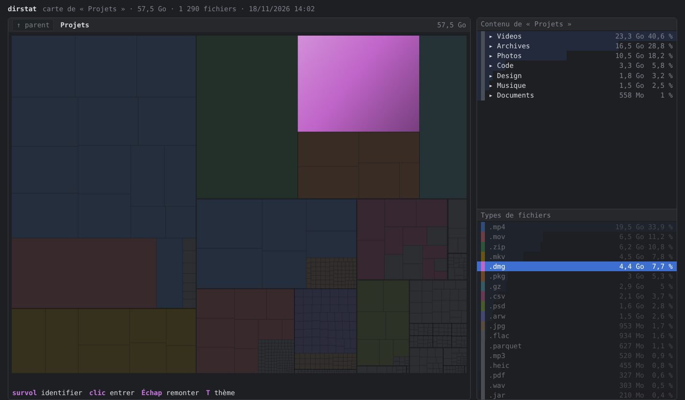

# dirstat

**[Essayer en ligne →](https://antoine123456.github.io/dirstat/)** — a scan of a sample folder, nothing to install

A WinDirStat-style disk usage map for macOS (and Linux): one Python script that scans a folder and generates a self-contained, interactive treemap as an HTML page.



Every file is a rectangle sized by its weight and coloured by its type, so the biggest space hogs stand out at a glance.

## Features

- **Treemap**: squarified layout, shaded tiles, folder outlines.
- **Hover**: name, size, share of the current folder and full path.
- **Drill down**: click a folder to zoom in; go back up with `Esc`, `↑ Parent` or the breadcrumb.
- **Contents panel**: the current folder's items, sorted by size.
- **File types panel**: total size per extension; click one to highlight those files on the map.
- **Touch screens**: tap to identify a tile, tap again to enter its folder.
- **Light and dark themes**: same look as [kanban-terminal](https://antoine123456.github.io/kanban-terminal/); follows the system setting, `T` toggles.



## Requirements

- Python 3.8 or later (the one that ships with macOS works). No packages to install.
- Any modern browser to view the result.

## Usage

1. Download the script:

   ```bash
   curl -O https://raw.githubusercontent.com/antoine123456/dirstat/main/dirstat.py
   ```

2. Scan a folder:

   ```bash
   python3 dirstat.py ~/Documents
   ```

   The scan is read-only. When it finishes, `dirstat-Documents.html` is written in the current folder and opens in your browser.

3. Explore the map: hover to identify files, click to enter a folder, `Esc` to go back up.

### Options

| Option | Effect |
| --- | --- |
| `-o FILE`, `--output FILE` | HTML file to write (default: `dirstat-<folder>.html`) |
| `--no-open` | Don't open the browser when done |

### Examples

```bash
# Your whole home folder
python3 dirstat.py ~

# An external drive
python3 dirstat.py "/Volumes/Backup Plus" -o backup.html
```

On macOS, the first scan of a protected folder (Documents, Desktop, Downloads, external drives) may trigger a permission prompt for Terminal. Folders it can't read are skipped.

## How it works

1. `os.scandir` walks the folder recursively, skipping symlinks, and records each file's size.
2. To keep the page light on very large folders, files smaller than 1/100,000 of the total are merged per folder into a grey `(N petits fichiers)` tile, counted as `(divers)` in the types list.
3. The tree is embedded as JSON into a single HTML file, which lays out and draws the treemap on a canvas. Nothing is sent anywhere.

## Online demo

The [online demo](https://antoine123456.github.io/dirstat/) is `docs/index.html`, generated by `docs/make_demo.sh`: it builds a fake `Projets` folder out of empty sparse files (so it takes almost no disk space), scans it with `dirstat.py` and adds the demo banner. Run the script again to refresh the demo after changing `dirstat.py`.

## Limitations

- View only: there is no delete or cleanup action.
- The interface is in French.
- Scanning hundreds of thousands of files takes a while (about a minute for ~800,000 files on an SSD); external hard drives are slower.
- The map is a snapshot: re-run the script to refresh it.
